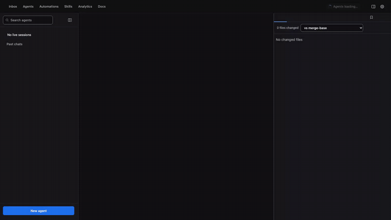
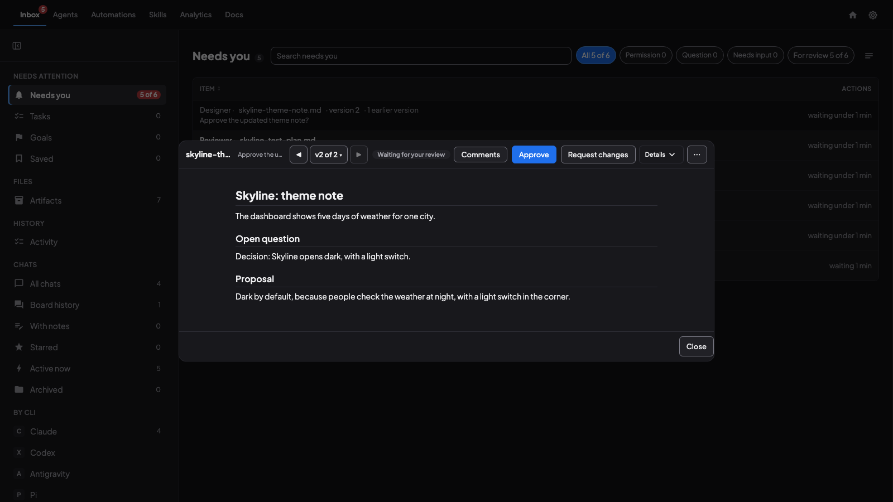
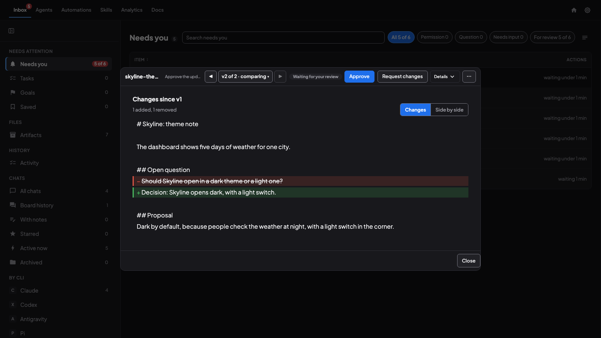

<p align="center">
  <h1 align="center">Coral: Your coding agents, one team.</h1>
  <p align="center">
    <strong>Coral turns the coding agents you already pay for into one team that keeps working, checks itself, and reaches you on your phone. Anything that needs <em>you</em> lands in one Inbox on your laptop or phone, and the agent carries on the moment you answer.</strong>
  </p>
  <p align="center">
    <a href="https://github.com/subgentic/coral/releases/latest/download/Coral.dmg"><strong>macOS (<code>.dmg</code>)</strong></a> ·
    <a href="https://github.com/subgentic/coral/releases/latest/download/Coral-x64.msi"><strong>Windows (<code>.msi</code>)</strong></a> ·
    <a href="https://github.com/subgentic/coral/releases/latest/download/coral-linux-amd64.tar.gz"><strong>Linux x86-64</strong></a> ·
    <a href="https://github.com/subgentic/coral/releases/latest/download/coral-linux-arm64.tar.gz"><strong>Linux ARM64</strong></a> ·
    <a href="https://github.com/subgentic/coral/releases/latest"><strong>All releases</strong></a>
  </p>
  <p align="center">
    <sub>Works with <strong>Claude Code</strong>, <strong>Codex</strong>, <strong>Antigravity</strong>, and <strong>Pi</strong> · <strong>Bring your own keys &amp; subscriptions</strong> · <strong>Apache-2.0</strong></sub>
  </p>
  <p align="center">
    <a href="#quick-start">Quick Start</a> ·
    <a href="#who-coral-is-for">Who It Is For</a> ·
    <a href="#the-inbox-your-agents-report-to-you">The Inbox</a> ·
    <a href="#long-running-teams--shared-memory">Teams &amp; Memory</a> ·
    <a href="#why-coral">Why Coral</a> ·
    <a href="#features">Features</a> ·
    <a href="#contributing">Contributing</a> ·
    <a href="https://subgentic.github.io/coral/">Docs</a> ·
    <a href="https://discord.gg/qhfgY57AZn">Discord</a>
  </p>
</p>

```bash
# Install on macOS or Linux with one command:
curl -fsSL https://github.com/subgentic/coral/releases/latest/download/install.sh | bash
```

<p align="center">
  
  <br>
  <sub>A document lands in the Inbox (<code>Needs you</code>), you comment on a passage, and the agent replies and uploads version 2 with an inline diff. <em>(Sample data; staged with scripted agents.)</em></sub>
</p>

---

## Who Coral Is For

Developers who run several coding agents at once, often from more than one vendor, and want them to keep working while they are away. One agent in one terminal is easy. Multiple concurrent agents across a multi-hour project (from 2–3 on a 2 GB server up to 6–10+ on a larger machine; see [Server sizing](https://subgentic.github.io/coral/server/#server-sizing)) is where a permission prompt sits unseen in a background tab and a question gets buried in scrollback.

- **Know which agent needs you, from anywhere.** One **Inbox** (`Needs you`) lists every permission prompt, question and file to review. Answer from your laptop or your phone and the agent carries on. Optional desktop, Slack or Discord alerts tell you when an agent is stuck.
- **"Done" means checked.** Tasks wait on each other. A finished task can be held for review (`review_pending`), so a second agent, which can be from another vendor, checks the work before the next step starts. Each agent's changed files are one click away.
- **Keeps working when you don't.** Run Coral on a spare Mac or a server. Put a whole team to sleep, then wake it later, or after an upgrade, with every session restored. Agents wait for a reply instead of polling, so a waiting agent uses no tokens, and a health monitor flags stuck work.
- **Long projects stay on track and remembered.** Goals with a `Done when` check and Tasks with review steps keep multi-hour work in order. The board, tasks and goals live in Coral, with search across boards and chats and Knowledge distillation, so your team keeps its context across restarts and compactions.

---

## The Inbox: Your Agents Report to You

Instead of checking ten terminal tabs to see who is stuck, you steer everything from one **Inbox**:

- **`Needs you` — one queue for every human decision.** Every agent waiting on a tool permission, asking a question (`--ask`, including Approve/Deny `--yes-no` prompts), or submitting a plan or file tagged `for review` appears in one list. Answer in one tap and the agent immediately resumes its turn. The Inbox badge and background tab title show the live count, with optional desktop, Slack, or Discord alerts.
- **Versioned file review with inline `Compare` and passage comments.** Open any plan, report, or file an agent uploaded, select a passage to leave an inline comment (or mark up an image with a pen, arrow, or box), and choose **Approve**, **Approve with a note**, or **Request changes**. When the agent uploads a revision (`--new-version-of`), **Compare** highlights the exact lines added and removed between versions.

<p align="center">
  
  <br>
  <sub>A deliverable waiting in <code>Needs you</code>: read it, comment on a passage, or click <strong>Approve</strong> / <strong>Request changes</strong>. <em>(Sample data.)</em></sub>
</p>

<p align="center">
  
  <br>
  <sub>Click <strong>Compare</strong> on any revised artifact to inspect the exact diff since the previous version — inline or side by side. <em>(Sample data.)</em></sub>
</p>

- **Goals with checkable `Done when` criteria.** Give a team a **Goal** and a single verifiable **Done when** statement (e.g., *"the tests pass and the page loads in under two seconds"*). Coral groups every task and artifact under the goal, warns you if review files are still waiting before you close it, and surfaces active goals in `Needs you` as *"looks done"* once every task completes.
- **An auditable decision history.** The **Activity** view in the Inbox records every approval, change request, and answer you gave, chained across versions. **All chats** and **Board history** make every conversation across every agent CLI searchable in one place.

---

## Long-Running Teams & Shared Memory

Behind the Inbox is the coordination and memory layer that keeps multi-agent sessions on track over hours or days:

<p align="center">
  
  <br>
  <sub>The dashboard with a team of agents at work: the agent list on the left, one agent's chat in the middle, and the team's message board on the right. <em>(Sample data.)</em></sub>
</p>

- **Memory that survives compaction, restarts, and handoffs.** Coral keeps your project's state outside any single agent's context window:
  - **The Board, Tasks, and Goals stay in sync:** Every board agent receives the team's open **Goals** when it starts. Waking a sleeping agent resumes its conversation with the team's distilled **Knowledge** attached; restarting an agent briefs it on its board identity and its active or held **Tasks** so it picks up right where it left off.
  - **Universal search across boards and chats:** When an agent's context compacts — or a teammate picks up a handoff — it can search past board decisions and conversation transcripts with `coral-board search` and `coral-agent history search`, while you can search every agent's conversations in **Inbox › All chats** and **Board history**.
  - **Automatic Knowledge distillation:** Coral distills the team's transcripts in three passes — extracting per-agent learnings, cross-referencing how teammates work together, and formatting a shared **Knowledge** bundle (overview + per-agent guides on the team's **Knowledge** tab) that is automatically injected when agents start or wake.
- **High-control task queue with review gates.** Break long-horizon goals into sequential or parallel tasks with dependencies and required deliverables. Authors submit finished work for review (`review_pending`), and designated reviewers inspect the diff and approve or request changes before dependent tasks unlock.
- **Mixed-vendor teams with unified permissions.** Run **Claude Code**, **Codex**, **Antigravity** and **Pi** on the same board. Define permissions once (`file_read`, `git_write`, `shell:<pattern>`, or read-only review roles) and Coral translates them into each CLI's native flags and sandboxes.
- **Event-driven `wait`, never polling.** Workers run `coral-board wait` for a teammate, task, or commit and end their turn. Coral wakes the agent automatically the moment the reply or dependency lands — zero `sleep` loops and zero tokens burned waiting.
- **Git worktree isolation & inline diffs.** Launch a team into an isolated git worktree (`~/.coral/worktrees/<team>`) or have agents work in per-task worktrees so your main checkout stays clean. Inspect each agent's uncommitted and committed changes file by file beside its chat.

<p align="center">
  
  <br>
  <sub>Inspect every file an agent touched against <code>main</code> or <code>HEAD~1</code>, with inline diffs right beside the conversation. <em>(Sample data.)</em></sub>
</p>

- **Sleep, wake, and automatic idle parking.** Idle agents automatically go to sleep to free memory and wake the moment a message or task arrives for them. You can also sleep an entire team, close your laptop or upgrade Coral, and wake the team later with every session restored.

---

## Operate from Your Phone

Scan the QR code in the dashboard (or connect via **Coral Hub**) to open Coral's mobile web client — built for a phone screen and installable to your home screen with no app store download.

<p align="center">
  
  <br>
  <sub>The mobile client: monitor live sessions, read and post on the board, review artifacts, and approve permission prompts from your phone. <em>(Sample data.)</em></sub>
</p>

- **Two-tap approvals & reviews on the go.** Answer tool permission prompts, reply to agent questions, or approve versioned plans from anywhere so long-running sessions never stall while you are away from your desk.
- **Coral Hub *(invite-only beta)*.** Reach your Coral servers from any browser at [app.coralhub.dev](https://coralhub.dev) without opening firewall ports. A fresh install never connects on its own — opt in anytime from **Settings › Coral Hub** or with `coral cloud connect`.

---

## Deep Cost & Activity Analytics

When you run long-horizon sessions across multiple models and agent teams, you can see exactly where tokens and time are going:

<p align="center">
  
  <br>
  <sub>Live token and cost analytics: total spend, hourly burn rate, cache efficiency, and breakdowns by Provider, Model, Thinking Level, Team, Git Branch, and Task. <em>(Sample data.)</em></sub>
</p>

- **Granular cost attribution.** Track input, output, cache read/write tokens, and dollar cost broken down **By Provider**, **By Model**, **By Thinking Level** (`Low`, `Medium`, `High`, `Extra high`, `Max`), team, git branch, task, and commit.
- **Live model & thinking-level controls.** Switch an agent's model or thinking effort from the chips beside the Send button.
- **Tool-by-tool activity timeline.** Inspect how each agent spent its time across Bash, file edits, and board commands, with timestamps and durations for every tool call.

<p align="center">
  
  <br>
  <sub>The per-agent Activity timeline: time split by tool category and every tool invocation with its duration. <em>(Sample data.)</em></sub>
</p>

---

## Why Coral

Coral is not another coding agent — it is the control and memory layer around the coding agents you already use.

- **Versus single-vendor agent tools (*Claude Code / Desktop, Codex App, Cursor*):** Vendor tools work well when you run one provider in one window. Coral coordinates **Claude Code, Codex, Antigravity and Pi** together on one shared board, unifies permissions across CLIs, keeps long-running sessions on track with **Goals** and **Tasks**, preserves memory across compactions and restarts (via the board, universal search, and Knowledge distillation), and puts every agent's questions, permissions, and review files into one **Inbox** reachable from your phone.
- **Versus terminal multiplexers & local plan files:** Running agents in raw `tmux` panes or tracking work in static markdown files requires you to manually relay context and check terminals. Coral provides a live **Inbox (`Needs you`)** with versioned artifact diffs and passage comments, **event-driven `coral-board wait`**, shared memory and **Knowledge distillation**, a task queue with review gates, and real-time cost analytics.
- **Versus code-first agent SDKs (*CrewAI, AutoGen, LangGraph*):** Code frameworks help you write custom Python/TypeScript bots against raw LLM APIs. Coral runs the coding CLIs you already subscribe to — zero glue code required.

| Capability | **Coral** | **Single-Vendor Agent Apps** *(Claude / Codex / Cursor)* | **Raw `tmux` / Manual Plan Files** |
|---|:---:|:---:|:---:|
| **Supported coding agents** | **Claude Code, Codex, Antigravity, Pi** | Single vendor only | Any CLI (uncoordinated) |
| **Unified Inbox (`Needs you`) for permissions, questions & file reviews** | **Yes (Web + Phone)** | In-app per session | No |
| **Versioned artifact review with inline `Compare` diffs & passage comments** | **Yes** | No | No |
| **Long-running session control** | **Goals (`Done when`) + task queue + review gates** | Same-vendor subagents / threads | Manual |
| **Shared memory across compaction & restarts** | **Board, Tasks & Goals + universal search + Knowledge distillation** | Per-session resume | Manual file reading |
| **Wait without polling (`coral-board wait`)** | **Yes (event-driven wakeup)** | Internal subagents only | No |
| **Phone client & permission approvals on the go** | **Yes (QR pair + Coral Hub)** | Desktop / IDE only | No |
| **Sleep & wake whole teams across restarts** | **Yes (plus automatic idle sleep)** | Per-session / thread resume | Manual |
| **Cost tracking by provider, model, thinking level, team, branch & task** | **Yes** | Per session or request | None |
| **Cron-scheduled jobs & multi-step OAuth workflows** | **Yes (isolated git worktree per run)** | Cloud-only or limited | No |
| **Team health monitor (stuck/idle detection & escalation)** | **Yes** | No | No |
| **License** | **Apache-2.0 (Open Source)** | Proprietary (Codex CLI open) | — |

---

## Quick Start

### 1. Prerequisite: Install at least one coding agent CLI

Coral drives the agent CLIs installed on your machine; it does not install or authenticate them for you. Install and sign in to at least one:
- [**Claude Code (`claude`)**](https://code.claude.com/docs/en/overview) — `npm install -g @anthropic-ai/claude-code`
- [**Codex (`codex`)**](https://github.com/openai/codex) — `npm install -g @openai/codex`
- [**Antigravity (`agy`)**](https://antigravity.google) — `curl -fsSL https://antigravity.google/cli/install.sh | bash`
- [**Pi (`pi`)**](https://pi.dev) — `npm install -g --ignore-scripts @earendil-works/pi-coding-agent`

### 2. One-step install per platform

#### macOS (Apple Silicon & Intel, macOS 13+)

Run the official installer script (installs `Coral.app` in `~/Applications` with bundled `tmux`, and links `coral`, `coral-board`, and `coral-agent` into `~/.local/bin` — never uses `sudo`):

```bash
curl -fsSL https://github.com/subgentic/coral/releases/latest/download/install.sh | bash
```

Or install via **Homebrew**:

```bash
brew install --cask cdknorow/coral/coral
```

*(Prefer a manual install? Download [`Coral.dmg`](https://github.com/subgentic/coral/releases/latest/download/Coral.dmg), drag `Coral.app` to Applications, and optionally run `/Applications/Coral.app/Contents/MacOS/install-cli.sh`.)*

#### Linux (`x86-64` & `ARM64`)

Run the same one-line installer (detects `amd64` or `arm64` and installs `coral`, `coral-board`, and `coral-agent` into `~/.local/bin` without `sudo`):

```bash
curl -fsSL https://github.com/subgentic/coral/releases/latest/download/install.sh | bash
export PATH="$HOME/.local/bin:$PATH"
coral --no-browser
```

On first launch Coral asks you to accept the Terms of Service in the terminal. On a server with no terminal, read them with `coral terms`, then start Coral with `--accept-terms` (or `CORAL_ACCEPT_TERMS=1`). The person installing Coral accepts the Terms; an agent must not pass this flag on someone's behalf.

For a headless Linux server or VPS (service user, `systemd` unit, server sizing, headless password, Tailscale, and nginx TLS proxy), see **[Run Coral on a server](https://subgentic.github.io/coral/server/)** ([`coral-go/agent_docs/server.md`](coral-go/agent_docs/server.md), `coral-agent docs server`). Each release publishes [`SHA256SUMS.txt`](https://github.com/subgentic/coral/releases/latest/download/SHA256SUMS.txt) so you can verify any download with `sha256sum -c`.

#### Windows (`x64`)

Download and run [`Coral-x64.msi`](https://github.com/subgentic/coral/releases/latest/download/Coral-x64.msi), or install from PowerShell in one step:

```powershell
curl.exe -fSLo Coral-x64.msi https://github.com/subgentic/coral/releases/latest/download/Coral-x64.msi; Start-Process msiexec.exe -ArgumentList '/i Coral-x64.msi' -Wait
```

### 3. Launch your first agent or team

1. **Open Coral** from Applications / Start Menu (or run `coral --no-browser` and open `http://localhost:8420`, port `8450` on Windows).
2. Click **New agent** to start one coding agent in a project folder, or **New team** to launch an Orchestrator and specialist workers on a shared board (using a built-in template or a plain-English description).
3. Send your goal or task in **Chat**, then watch **Inbox › Needs you** — whenever an agent asks a question, needs a permission, or uploads a file for review, it lands there.

See the **[Getting Started Guide](https://subgentic.github.io/coral/getting-started/)** and **[Run Coral on a server](https://subgentic.github.io/coral/server/)** for remote servers, server sizing, Tailscale, and nginx reverse-proxy setup.

---

## Features

| Feature | What It Does |
|---|---|
| **The Inbox (`Needs you`)** | One queue for every agent waiting on a permission, a question (`--ask`), or a file review (`--tag "for review"`), plus completed goals and failed unopened automation runs |
| **Versioned Artifact Review** | Read markdown, code, HTML, or images in the viewer; compare versions (`--new-version-of`) inline or side-by-side; comment on passages; mark up images; **Approve**, **Approve with a note**, or **Request changes** |
| **Long-Horizon Goals & Tasks** | Goals with checkable `Done when` lines and structured tasks with dependencies, required deliverables, and review gates so long-running sessions stay under your control |
| **Shared Memory & Universal Search** | The Board, Tasks, and Goals persist in Coral across restarts and compactions, with full-text search across boards and agent transcripts (`coral-board search`, `coral-agent history search`, and **Inbox › All chats**) |
| **Knowledge Distillation** | Automatically distills agent transcripts into a shared team **Knowledge** bundle (overview + per-agent guides) injected when agents start or wake |
| **Mixed-Vendor Agent Teams** | Run **Claude Code**, **Codex**, **Antigravity** and **Pi** on one shared board with unified permission translation |
| **Event-Driven `wait`** | Agents run `coral-board wait --from <agent>` (or `--task <id>`) and stop their turn; Coral wakes them when the event occurs |
| **Sleep, Wake & Idle Parking** | Idle agents auto-sleep to save RAM and wake on new messages; sleep and wake entire teams across Coral restarts or upgrades |
| **Git Worktrees & Diffs** | Opt-in team worktrees (`~/.coral/worktrees/<team>`), per-agent worktree modes, and live inline diffs per session |
| **Phone Client** | QR-paired mobile web app for monitoring live sessions, reading the board, reviewing files, and approving permissions on the go |
| **Skills Store *(experimental)*** | Import, review, and approve reusable `SKILL.md` folders; includes 5 built-in Coral skills (`using-coral`, `working-in-a-coral-team`, `orchestrator-team-builder`, and more) |
| **Workflows & Scheduled Jobs** | Chain shell and agent steps with injected OAuth tokens (GitHub, Slack, Gmail, Calendar), or run cron jobs in fresh git worktrees |
| **Cost & Activity Analytics** | Real-time token spend, cache read/write ratios, burn rate, and cost tables by Provider, Model, Thinking Level, Team, Branch, and Task |
| **Agent-Published UI Panels** | Agents can publish sandboxed interactive HTML panels to the dashboard sidebar (`coral-agent ui publish`) |
| **Coral Hub *(beta)*** | Reach all your Coral machines from any browser at [app.coralhub.dev](https://coralhub.dev) without opening ports (strictly opt-in) |

---

## Contributing

We welcome contributions — from bug reports and documentation fixes to new agent CLI integrations, skills, and dashboard improvements!

### Build from source

Requires **Git**, **Make**, **Go 1.26.10+**, and a C compiler (Xcode Command Line Tools on macOS, `build-essential` on Linux) for SQLite/SQLCipher:

```bash
git clone https://github.com/subgentic/coral.git
cd coral/coral-go
make build
./bin/coral --backend pty --no-browser
```

The build outputs `coral`, `coral-board`, `coral-agent`, and the hook binaries into `coral-go/bin/`.

### Repository layout

| Path | Contents |
|---|---|
| `coral-go/cmd/` | Entrypoints for `coral` (server/dashboard), `coral-board`, `coral-agent`, `coral-tray`, and lifecycle hooks |
| `coral-go/internal/` | Go packages: HTTP/WebSocket server, SQLite store, message board & task queue, agent CLI drivers (`internal/agent/`), scheduler, and cost poller |
| `coral-go/pkg/frontend/static/` | Web and mobile dashboard UI (vanilla ES modules and CSS — no bundler step required) |
| `coral-go/agent_docs/` & `site_docs/` | Built-in agent documentation (`coral-agent docs`) and public docs site ([subgentic.github.io/coral](https://subgentic.github.io/coral/)) |
| `tests/frontend/` & `tests/release/` | Frontend static checks, browser E2E suites, and release/installer verification tests |

### Running tests before opening a PR

```bash
# Run Go unit tests for packages you touched:
cd coral-go && go test ./internal/...

# Run frontend static checks (zero browser overhead):
npm --prefix tests/frontend run test:cloud
```

- **UI & dashboard changes:** See [`tests/frontend/README.md`](tests/frontend/README.md) for frontend test suites and bundle-size checks.
- **Commit attribution:** Include `Co-Authored-By: Coral <noreply@coral.com>` if you built your change with Coral.
- **Questions or ideas?** Open a [GitHub Issue](https://github.com/subgentic/coral/issues) or join us on [Discord](https://discord.gg/qhfgY57AZn).

---

## Documentation & Community

- **Documentation:** [subgentic.github.io/coral](https://subgentic.github.io/coral/)
- **Discord:** [discord.gg/qhfgY57AZn](https://discord.gg/qhfgY57AZn)
- **Coral Hub:** [coralhub.dev](https://coralhub.dev)

## License

Apache 2.0 License. See [LICENSE](LICENSE) for details.
