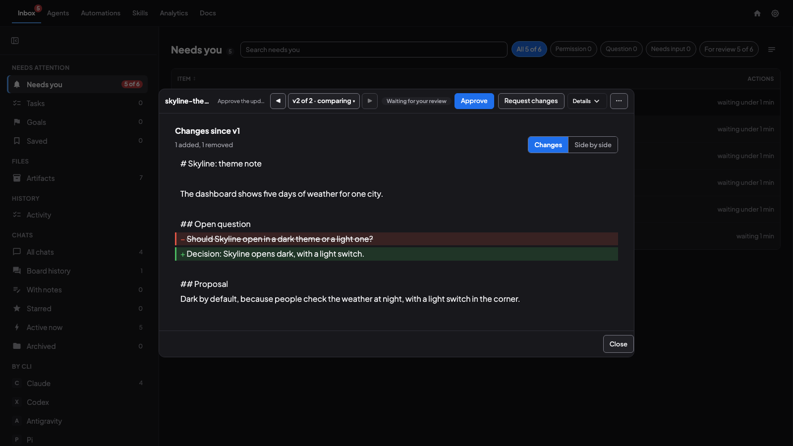

<p align="center">
  <strong>Coral: the Inbox for your agents.</strong>
</p>

<p align="center">
  Your coding agents do the work. Anything that needs <em>you</em> &mdash; a question, a permission, a file to review &mdash; lands in one Inbox, on your laptop or your phone, and the agent carries on the moment you answer.
</p>

<p align="center">
  <a href="https://github.com/subgentic/coral/releases/latest/download/Coral.dmg">macOS (.dmg)</a> &bull;
  <a href="https://github.com/subgentic/coral/releases/latest/download/Coral-x64.msi">Windows (.msi)</a> &bull;
  <a href="https://github.com/subgentic/coral/releases/latest/download/Coral-x64-portable.zip">Windows portable (.zip)</a> &bull;
  <a href="https://github.com/subgentic/coral/releases/latest/download/coral-linux-amd64.tar.gz">Linux x86-64</a> &bull;
  <a href="https://github.com/subgentic/coral/releases/latest/download/coral-linux-arm64.tar.gz">Linux ARM64</a> &middot; <a href="https://github.com/subgentic/coral/releases/latest">all releases</a><br>
  Apache-2.0 &middot; no account, nothing to sign up for &middot; you keep your own keys and subscriptions &middot; works with Claude Code, Codex, Antigravity, Pi, OpenCode and Hermes (experimental)</sub>
</p>

<p align="center">
  <a href="https://github.com/subgentic/coral"></a>
  <a href="https://github.com/subgentic/coral/blob/main/LICENSE"></a>
  <a href="https://subgentic.github.io/coral/"></a>
  <a href="https://discord.gg/qhfgY57AZn"></a>
</p>

<p align="center">
  <a href="#the-inbox">The Inbox</a> &bull;
  <a href="#chief-your-front-agent">Chief</a> &bull;
  <a href="#a-team-with-an-orchestrator">Teams</a> &bull;
  <a href="#quick-start">Quick Start</a> &bull;
  <a href="https://subgentic.github.io/coral/">Documentation</a> &bull;
  <a href="https://discord.gg/qhfgY57AZn">Discord</a>
</p>

<p align="center">
  
  <br>
  <sub>A file an agent made, waiting for your review: read it, Approve or Request changes.</sub>
</p>

---

<p align="center">
  <strong>Install on macOS or Linux with one command:</strong>
</p>

```bash
curl -fsSL \
  https://raw.githubusercontent.com/subgentic/coral/main/install.sh \
  | bash
```

## The Inbox

Running agents is easy. *Knowing when one of them needs you* is the part that goes wrong: a permission prompt sits for an hour in a terminal you closed, a question waits behind a tab you forgot, a finished file never gets looked at. Coral puts all of that in one place.


- **Needs you.** Every agent that is waiting for a permission, a question or a decision, and every file an agent asks you to review, in one list. One tap answers it; the agent carries on. The number on the Inbox tab is what is waiting, and you can turn on desktop alerts. While the tab is in the background its title carries the total too.


-  **Review that keeps its history.** Open a file the agent made, read it, **Approve** or **Request changes**. A new version of the same file arrives as the next version with **Compare**, so you see what changed. Comment on the whole document or a passage, and add a picture you have marked up (pen, arrow, box); the agent is told, and the original is kept. A file that is almost right can be **approved with a note**, and a row you do not want to act on can be **dismissed** (with Undo).
- **Goals you can close.** Give a team a goal, watch its tasks and files, and **Close goal** when it is true. Coral tells you when files for a goal are still waiting for you before you close it, and an active goal whose tasks are all done shows up in Needs you as "looks done" for you to close.
- **A question to you is an item like a review.** It says who asked and about which goal and task, shows its words rendered, and takes your reply with pictures if you want them; a question whose wait ran out while you were away is kept, not lost.
- **Comments come back to you.** When an agent answers a comment on a file or a goal, the file is back in Needs you, and the goal page has its own Comments tab.
- **A compact file viewer.** The file first, with its controls on one header row (version chip and Compare, Approve, Request changes, a menu for the rest); on a phone, two thin rows.
- **A record of what you decided.** An Activity folder lists your decisions in Needs you, each row chained to the one before it.
- **Every chat and every board, searchable.** The Inbox also holds the history of every agent CLI's conversations and each team's message board.

<p align="center">
  
  <br>
  <sub>Compare with the earlier version: what changed, marked. (Sample data.)</sub>
</p>

Coral wraps the agent CLIs you already use (Claude Code, Codex, Antigravity, Pi and OpenCode, and Hermes, which is experimental). It calls no AI API itself: your keys, your subscriptions, your tools. It runs as one Go binary on your laptop or a remote box.

## Chief, your front agent

**Chief** is one of your running agents that you make the front door. In Settings > Chief you pick which agent it is, give it a name and an avatar (one of eight colours and a letter), and choose the team it fronts: the team whose agents Chief takes your requests to. Chief has its own page on your phone, `/chief`, with its own chat (you turn the page on in Settings). You decide how much it may do on its own: **Ask first** (the default) asks before each action; **Act** edits without asking, and a shell command still asks; the level applies when Chief restarts. Chief has to be an agent that is already running (on a team of its own, a team of one), and Settings > Chief is on the computer itself, not through Coral Hub.

## A team with an Orchestrator

Behind the Inbox is the part that does the work: a team of agents on one board. An **Orchestrator** plans and delegates; a **Lead Developer** writes the code; a **QA Engineer** checks it. They can be different vendors on the same team (a Claude orchestrator, Codex workers, an Antigravity reviewer), each in its own terminal session and, if you ask, its own git worktree. The team's board holds the messages and a task queue whose dependencies are conditioned on outcomes and artifacts, not just "done".

<p align="center">
  
  <br>
  <sub>The team's board beside one agent's chat: the Orchestrator and its workers at work. (Sample data.)</sub>
</p>

- **Mixed-vendor teams.** Permissions are written once and translated into each CLI's native format, so a read-only QA agent is read-only whether it is Claude or Codex.
- **Idle agents sleep by themselves.** An agent that has been idle for a while is put to sleep to free memory and wakes when something is sent to it; an agent mid-work stays awake. On by default, with a switch in Settings.- **A Skills Store (experimental).** Import a skill, review it, approve it; approved skills appear in New agent and New team, and agents can publish and search skills themselves.- **Teams that survive closing the lid.** Sleep a whole team and wake it tomorrow, or after upgrading Coral: every agent resumes its own session.
- **Run it anywhere.** Put Coral on a build server or a spare Mac; open it from any browser, or scan a QR code for a phone client.

Everything else is in the [feature list](#features).

---

## Quick Start

### Download a release

Download the latest release from [GitHub Releases](https://github.com/subgentic/coral/releases/latest). These links always point to the newest version:

- **macOS**: [`Coral.dmg`](https://github.com/subgentic/coral/releases/latest/download/Coral.dmg) (universal binary)
- **Linux**: [`coral-linux-amd64.tar.gz`](https://github.com/subgentic/coral/releases/latest/download/coral-linux-amd64.tar.gz) (x86-64) or [`coral-linux-arm64.tar.gz`](https://github.com/subgentic/coral/releases/latest/download/coral-linux-arm64.tar.gz) (ARM64, e.g. Graviton or Docker on Apple silicon)
- **Windows**: [`Coral-x64.msi`](https://github.com/subgentic/coral/releases/latest/download/Coral-x64.msi) (installer) or [`Coral-x64-portable.zip`](https://github.com/subgentic/coral/releases/latest/download/Coral-x64-portable.zip). These are currently **not code-signed**, so Windows SmartScreen warns that the publisher is unknown. Verify the file with the attestation check below before you run it.

Each release also keeps its versioned file names (`Coral.v<version>.dmg`, `coral-linux-<arch>-<version>.tar.gz`, `Coral-<version>-x64.msi`, `Coral-<version>-x64-portable.zip`): the same files.

Every release is signed; how to check a download is in the [release notes](https://github.com/subgentic/coral/releases/latest).

### Install and start

First install and sign in to at least one agent CLI: [Claude Code](https://code.claude.com/docs/en/overview), [Codex](https://github.com/openai/codex), [Antigravity (`agy`)](https://antigravity.google), [Pi](https://pi.dev), [OpenCode](https://opencode.ai), or Hermes (experimental). Coral runs these tools; it does not install or authenticate them.

- **macOS:** Open the DMG, drag `Coral.app` to Applications, then open Coral. The app includes tmux. For terminal commands, run `/Applications/Coral.app/Contents/MacOS/install-cli.sh` and add `~/.local/bin` to your `PATH`.
- **Windows:** Run the MSI, then open **Coral** from the Start menu. For the portable ZIP, extract it, open PowerShell in that folder, and run `.\coral.exe --no-browser`.
- **Linux:** Download the archive for your architecture, then extract and start it (ARM64: replace `amd64` with `arm64`):

  ```bash
  mkdir -p "$HOME/.local/share/coral"
  tar -xzf coral-linux-amd64.tar.gz -C "$HOME/.local/share/coral"
  export PATH="$HOME/.local/share/coral:$PATH"
  coral --no-browser
  ```

  Add that `PATH` line to your shell's startup file for later terminals. Agents run in Coral's built-in terminal and stop when you quit Coral. To keep them running after Coral quits, install tmux and choose it in Settings > Terminal, or start with `--backend tmux`. (With tmux, any agent can reach the other agents' terminals through its socket.)

On first launch, review the Terms of Service and accept them if you agree. For a terminal launch, keep the terminal open while Coral runs. Open the local address printed at startup. If the browser shows **Create a password**, enter and confirm a password, then choose **Create password and open Coral**. The app can open a signed-in browser directly; you can also run `coral open` from a terminal on the server.

In the dashboard, choose **New agent** (then **New agent** again in the dialog: "One agent in a folder you choose"), choose the agent in step 1, enter an existing project folder on the computer running Coral (or use **Browse**), and choose **Launch**. In the agent's **Terminal**, answer any folder-trust or sign-in prompt, then send a task from **Chat** with Enter. Choose **New team** instead to start several agents together.

See [Getting started](https://subgentic.github.io/coral/getting-started/) for the full installation and first-agent walkthrough.

### Build from source

Install Git, Make, Go 1.26.10 or later, and a C compiler (on macOS, Xcode Command Line Tools), then:

```bash
git clone https://github.com/subgentic/coral.git
cd coral/coral-go
make build
./bin/coral --backend pty --no-browser
```

The build puts the tools in `bin/`. For the commands below, add that directory to your `PATH` or use `./bin/coral` in place of `coral`.

### Use it from your phone

<p align="center">
  
  <br>
  <sub>The same dashboard on a phone: the agent list, and one agent's chat. (Sample data.)</sub>
</p>

On a phone you can:

- Watch every agent's live terminal and current goal
- Read and post on the board, and check task status
- Approve or deny an agent's permission prompt the moment it appears
- Sleep, wake, restart, or kill agents

### Coral Hub (beta)

Coral Hub (app.coralhub.dev, invite-only beta) lets you reach your Coral servers from any browser without opening a port. A fresh install never connects, or asks you to, on its own: connect a server from the home screen or **Settings › Coral Hub**, or run `coral cloud connect` on it. Coral offers it at first launch (the dashboard's Connect screen and a prompt in the terminal) only when you pass a hub URL (`--cloud-url https://app.coralhub.dev` or `CORAL_CLOUD_URL`) or start it with `--cloud-connect prompt` (`CORAL_CLOUD_CONNECT=prompt`); `--cloud-connect off` turns that off. See [Coral Hub](coral-go/agent_docs/hub.md#connecting-a-server-to-coral-hub).

## How a team works

### 1. Create a team

Define a team of agents, each with a role and a system prompt. For example: an Orchestrator that plans and delegates, a Lead Developer that writes code, and a QA Engineer that reviews and tests. You can create teams from the dashboard UI, use built-in templates, or describe what you need in plain English and let AI generate the team configuration.

<p align="center">
  
  <br>
  <sub><strong>+ New</strong> offers four things to launch: a single agent, a whole team on a shared board, a plain terminal that lives alongside your agents, or a folder pinned to your Agents list.</sub>
</p>

### 2. You monitor and steer from the dashboard

The web dashboard shows every agent's live terminal, current status, and message board activity. You can:
- Send messages or commands to any agent
- Sleep an agent (preserving full state) and wake it later
- Add new agents to a running team
- Answer an agent's permission prompt from the dashboard — including from your phone
- Define teams in JSON, import a skill folder as a team, or generate one from a plain-English description
- See what it all cost — by model, team, branch, and individual agent

## Features

- **One Inbox** for questions, permissions and files that need you, on a laptop or a phone.
- **Teams of agents** from different vendors, led by an Orchestrator, on one message board.
- **Chief**, your own front agent, on its own phone page.
- **Sleep and wake** an agent or a whole team, and idle agents sleep by themselves.
- **Scheduled jobs and workflows** that run on a cron schedule.
- **Cost** by agent, team and branch.

<p align="center">
  
  <br>
  <sub>Analytics: how much Coral is used and what it costs, by model, team, branch and agent. (Sample data.)</sub>
</p>

## Documentation

Full documentation at **[subgentic.github.io/coral](https://subgentic.github.io/coral/)**.

## Contributing

We welcome contributions! Whether it's adding support for new AI agents, improving the dashboard, or fixing bugs — please open an issue or submit a pull request.

Dashboard changes should follow the [Coral UI style guide](coral-go/docs/ui-style-guide.md).

## License

Apache 2.0 License. See [LICENSE](LICENSE) for details.

---

<p align="center">
  <a href="https://github.com/subgentic/coral">Star the repo</a> &bull;
  <a href="https://discord.gg/qhfgY57AZn">Join Discord</a> &bull;
  <a href="https://subgentic.github.io/coral/">Read the docs</a>
</p>
