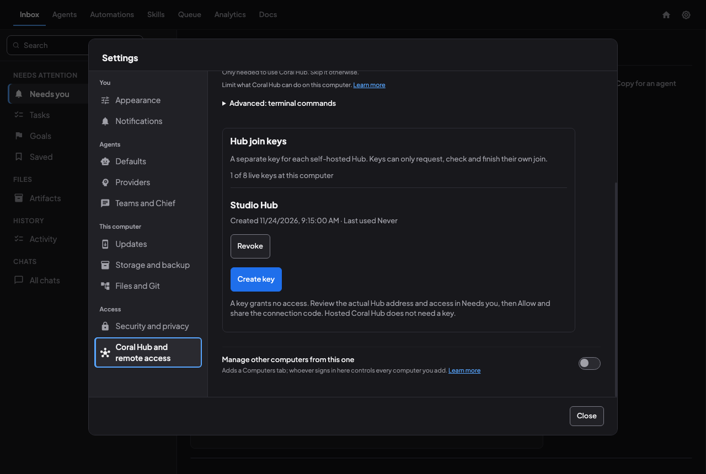
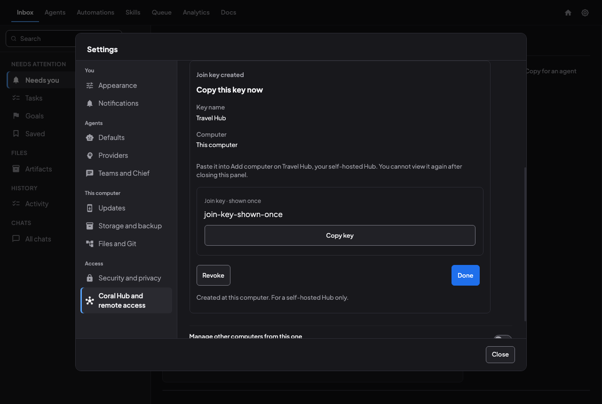

# Connect a second self-hosted Hub to a Coral

A Coral server can connect to more than one Hub at the same time (up to eight Hub connections). Use this tutorial when a self-hosted Hub needs to connect to a Coral server that may already be linked to another Hub.

These steps cover what ships in **Coral v2.1.9 and later**:

- **Method 1 (live today on Coral and Coral Hub): add or connect the Hub from the Coral server and approve it on the Hub's enroll page.** On the Coral server (over SSH or at the dashboard), run `coral cloud links add <hub address> <view|interact|launch>` for an additional Hub (or `coral cloud connect` / **Settings > Coral Hub and remote access > Connect** for the server's primary `--cloud-url` Hub). Coral prints the Hub's enrollment link and device code (`XXXX-XXXX`); you open the Hub's enroll page (`/enroll`), check the computer name and key fingerprint, press **Approve** (until the page shows **Computer verified**), and confirm the Hub's owner on the Coral server.
- **Method 2 (Coral-side join-key API, over SSH or HTTP with a join key): request a join with a join key and allow it in Coral's Inbox.** A self-hosted Hub automation or script can create a single-purpose request key on the Coral server (`coral cloud keys create "<name>"` over SSH, or in **Settings > Coral Hub and remote access > Hub join keys** at the computer), send a join request (`POST /api/cloud/link-requests`), and finish with the one-time 8-digit connection code you approve in **Inbox > Needs you** (**Another Hub wants to connect**) on the Coral computer. Because Coral Hub's web UI uses the normal `/enroll` page (Method 1) rather than a separate Hub-side join-key screen, Method 2 is driven from the command line or a script against Coral's `/api/cloud/link-requests` endpoints.

---

## Method 1: Connect from the Coral server and approve on the Hub's enroll page (live flow)

### 1. Start the link on the Coral server (over SSH or in the dashboard)

#### Adding a second Hub (`coral cloud links add`)

On the Coral server (for example over SSH), as the user Coral runs as, pass the second Hub's HTTPS address and the maximum access level (`view`, `interact`, or `launch`) it may have on this computer:

```sh
coral cloud links add https://hub-two.example.com launch
```

Coral asks that Hub for an enrollment code, prints what the chosen access level allows, and displays the Hub's verification link and device code (`XXXX-XXXX`):

```text
Adding https://hub-two.example.com. Once linked it may start sessions on this computer, and send to and answer your agents (access: launch).
Open https://hub-two.example.com/enroll?code=ABCD-EFGH in your browser and enter the code ABCD-EFGH
```

#### Connecting the server's configured `--cloud-url` Hub (`coral cloud connect` or Settings)

If the Hub you are linking is the server's configured `--cloud-url` (or `CORAL_CLOUD_URL`), you can instead run:

```sh
coral cloud connect
```

or open **Settings > Coral Hub and remote access** at the Coral computer, choose what Coral Hub may do on this computer (**View**, **Interact**, or **Launch**), and press **Connect** (or **Add a Hub** when another Hub link already exists). Coral shows the Hub's `/enroll` link, the `XXXX-XXXX` code, and this computer's key fingerprint to compare in your browser.

### 2. Approve the computer on the Hub's enroll page

1. Open the verification URL (`https://<your-hub>/enroll?code=XXXX-XXXX`) in your browser and sign in to your Hub account. (Or open **Computers > Add a computer** in the Hub, type the `XXXX-XXXX` code from Coral into **Code from Coral**, and press **Continue**.)
2. On the Hub's **enroll page**:
   - Check or edit the computer name in the **name box**.
   - Compare the computer's key fingerprint shown on the enroll page against the key fingerprint Coral printed in your terminal or in **Settings > Coral Hub and remote access**.
   - Press **Approve**.
3. The Hub enroll page confirms **Computer verified**, and the Coral server finishes storing the sealed link.

### 3. Confirm the Hub link's owner on the Coral server

When `coral cloud links add` finishes linking a second Hub, it prints the owner account that the Hub reported and asks you to confirm that owner on the Coral server before owner-only actions are allowed through that link:

```sh
coral cloud links confirm-owner https://hub-two.example.com <owner-id-shown-by-coral>
```

If the Hub did not name an owner during enrollment, run `coral cloud links arm-owner https://hub-two.example.com` on the Coral server and open this computer in that Hub as its owner within 60 seconds so Coral records the owner account.

---

## Method 2: Join-key request and the Coral Inbox Allow card (SSH or HTTP key)

Coral also includes a local join-key and **Inbox > Needs you** approval flow so a second self-hosted Hub (or an enrollment script you run for it) can request access without you starting the command on the Coral server first.

A join key grants **no access on its own**. It is accepted on only three endpoints (`POST /api/cloud/link-requests`, `GET /api/cloud/link-requests/{id}`, and `POST /api/cloud/link-requests/{id}/finish`) to start, check, and finish its own join request.

### 1. Create a join key (over SSH or in Settings at the Coral computer)

Up to **8 live join keys** can exist on a Coral computer at once.

#### Option A: Over SSH (`coral cloud keys create`)

From the self-hosted Hub machine (or your workstation), sign in to the Coral server over SSH as the user Coral runs as and create a request key for the Hub:

```sh
ssh coral@coral-server 'coral cloud keys create "Studio Hub"'
```

Coral prints a notice to standard error (`Made the request key <id> (Studio Hub). It is shown once, on the next line, and cannot be read again: keep it in the Hub.`) and prints the one-time key (`clk_...`) alone on standard output.

#### Option B: In the dashboard at the Coral computer (**Settings > Coral Hub and remote access**)

1. At the Coral computer's dashboard, open **Settings** (the gear icon in the top bar) and select **Coral Hub and remote access** (under **Access**).
2. Scroll to **Hub join keys** (*A separate key for each self-hosted Hub. Keys can only request, check and finish their own join.*). This section is shown only when you open the dashboard directly at the computer, never through a Hub.



3. Press **Create key**, enter a **Key name** (1 to 40 characters, such as `Travel Hub`), and press **Create key**.
4. Coral displays **Join key created — Copy this key now** with the **Join key · shown once** and a **Copy key** button. Copy the key before pressing **Done**; Coral stores only a hash and cannot show the key again after you close the panel.



### 2. Send the join request to the Coral server over HTTP

Using the join key (`X-Link-Request-Key`), send a join request naming the self-hosted Hub's HTTPS origin and the requested access level (`view`, `interact`, or `launch`):

```sh
curl -sS -X POST http://127.0.0.1:8420/api/cloud/link-requests \
  -H "X-Link-Request-Key: $JOIN_KEY" \
  -H "Content-Type: application/json" \
  -d '{"hub":"https://hub-two.example.com","cap":"launch"}'
```

Coral returns `request_id`, a one-time `poll_secret`, `"state": "pending"`, and `expires_at`, and places an approval card in **Inbox > Needs you** on the Coral computer.

### 3. Allow the request in Coral's Inbox and copy the 8-digit code

1. At the Coral computer's dashboard, open **Inbox > Needs you** (under **Waiting on you**). A card titled **Another Hub wants to connect** shows:
   - The key name that made the request (`via key <name>`, for example `via key Studio Hub`).
   - **Requesting Hub**, **Computer**, and **Access requested** (**View**, **Interact**, or **Launch**) with a summary of what that level allows.
   - How many Hub connections this computer has (`1 of 8 Hub connections`) and the notice: *Only allow a Hub you recognize. Your existing Hubs stay connected.*


2. Under **Allow access**, keep the requested level or choose a lower one (**View**, **Interact**, or **Launch**; you cannot grant more than the request asked for), then press **Allow** — or press **Deny** to refuse the request.
   - **Allow** works **only at the Coral computer**. Allowing a second Hub through an already-connected Hub is gated off.
   - Pressing **Allow** switches the card to **Finish connecting on the other Hub** (`Allowed · waiting for the code`) and displays a one-time **8-digit Connection code** (formatted as two four-digit groups, such as `7394 2186`) that expires in 5 minutes (`Code expires in 5:00 · Can be used once`), with **Copy code** and **Cancel connection** buttons.


### 4. Finish the join request with the 8-digit code and approve on the Hub enroll page

Submit the `poll_secret` and the 8-digit `code` (without spaces) to `/api/cloud/link-requests/<request_id>/finish` using the same join key:

```sh
curl -sS -X POST "http://127.0.0.1:8420/api/cloud/link-requests/$REQUEST_ID/finish" \
  -H "X-Link-Request-Key: $JOIN_KEY" \
  -H "Content-Type: application/json" \
  -d "{\"poll_secret\":\"$POLL_SECRET\",\"code\":\"$CODE_8_DIGITS\"}"
```

Coral verifies the one-time 8-digit code and starts the enrollment with the allowed Hub origin and access cap, returning the Hub's `verification_url` and `user_code` in `enrollment`. Open that `verification_url` on the self-hosted Hub's enroll page, check the computer name and key, press **Approve** (**Computer verified**), and confirm the owner with `coral cloud links confirm-owner` as in Method 1.

---

## Managing Hub links and join keys afterwards

All link and key management runs **on the Coral server itself** (at the computer's dashboard or through `coral cloud` on that machine, authenticated by Coral's local command-line token).

### Manage Hub links (`coral cloud links`)

| Task | Command on the Coral server |
| --- | --- |
| List all connected Hubs | `coral cloud links list` |
| Add another Hub from the Coral server | `coral cloud links add <hub address> view\|interact\|launch` |
| Confirm the owner of an added Hub | `coral cloud links confirm-owner <hub address> <owner id>` |
| Change a Hub's maximum access level | `coral cloud links cap <link id or hub address> view\|interact\|launch` |
| Remove a linked Hub | `coral cloud links remove <link id or hub address>` |

- **`coral cloud links list`** prints each link's ID, current maximum access mode (`view`, `interact`, or `launch`), state, Hub address, and label. You can also change each link's access level or press **Remove** in **Settings > Coral Hub and remote access** at the Coral computer.
- **`coral cloud links cap`** raises or lowers what that Hub is allowed to do on this computer immediately:
  - `view`: read agents, chats, boards, and files.
  - `interact`: includes `view`, plus send messages, answer prompts, and interact with running agents.
  - `launch`: includes `view` and `interact`, plus start, stop, sleep, wake, and restart agents or teams, browse folders, pause boards, delete board content, and turn on auto-accept.
- **`coral cloud links remove`** disconnects that Hub from this computer and revokes the grants it signed.

### Manage Hub join keys (**Settings** or `coral cloud keys`)

You can list, create, and revoke join keys in **Settings > Coral Hub and remote access > Hub join keys** at the computer, or from the terminal:

| Task | Command on the Coral server |
| --- | --- |
| List active join keys (ID, name, created time, last used time; never the key secret) | `coral cloud keys list` |
| Create a new join key for a self-hosted Hub (up to 8 live keys) | `coral cloud keys create "<name>"` |
| Revoke a join key | `coral cloud keys revoke <key id>` |

### Revoking a join key vs. removing a Hub link

A **join key** and a **Hub link** are separate:

- **Revoking a join key** (`coral cloud keys revoke <key id>` or **Revoke** under **Hub join keys** in Settings) stops that key from starting, checking, or finishing any join request, and ends any request that key left waiting in **Inbox > Needs you**. **It does not disconnect a Hub that has already finished linking.**
- **Removing a Hub link** (`coral cloud links remove <link id or hub address>`) disconnects an already-linked Hub so it can no longer access the Coral server. If that Hub still holds an unrevoked join key and you do not want it to ask to join again, revoke its join key as well.

---

## Notes and limits

- **Up to 8 Hub connections and 8 live join keys.** A Coral server allows at most 8 linked Hubs and 8 live join keys at one time. Revoke an unused key before creating a ninth.
- **What a join key can do.** A join key is accepted on only three endpoints (`POST /api/cloud/link-requests`, `GET /api/cloud/link-requests/{id}`, and `POST /api/cloud/link-requests/{id}/finish`) to start, check, and finish its own join request. It is refused everywhere else.
- **Cooldown after repeated denials.** If requests from the same Hub are denied twice, that Hub is muted from asking again for one hour.
- **Wrong-code protection.** After too many wrong 8-digit code attempts across the server within 10 minutes, finishing a join request pauses briefly before trying again.
- **Built-in multi-server hub mode.** If you want one Coral server to pull in other Coral servers directly without running a separate Coral Hub service, see [Multi-server hub](multi-server-hub.md).
