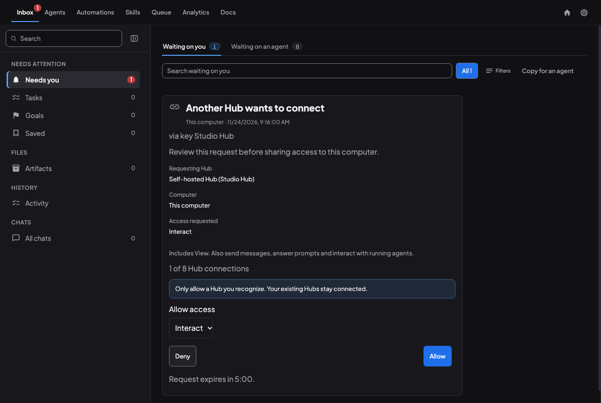
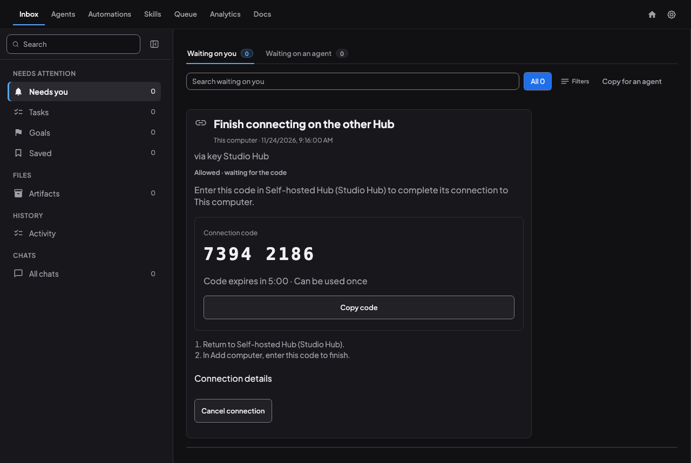

# Connect a second self-hosted Hub to a Coral

A Coral server can connect to more than one Hub at the same time (up to eight Hub connections). Use this tutorial when a self-hosted Hub needs to join a Coral server that may already be linked to another Hub.

These steps cover what ships in **Coral v2.1.9 and later**:

- **Path 1 (recommended): connect over SSH.** The self-hosted Hub signs in to the Coral server over SSH, runs `coral cloud keys create <name>` to get its own single-purpose request key, and sends a join request over HTTP without you copying any key.
- **Path 2: connect over HTTP with a join key.** Create a join key on the Coral server (in **Settings > Coral Hub and remote access** under **Hub join keys**, or with `coral cloud keys create "<name>"`) and paste it into the self-hosted Hub.
- In both paths, a join key grants **no access on its own**. It only lets that Hub ask to join. You review the request at the Coral computer in **Inbox > Needs you**, choose **Allow** (with **View**, **Interact**, or **Launch**) or **Deny**, and enter the one-time 8-digit connection code in the new Hub.

!!! note "Hub-side screens are coming in `coral-hub`"
    The Coral server side (**Inbox > Needs you** join card, 8-digit one-time connection code, **Settings > Coral Hub and remote access > Hub join keys**, `coral cloud keys`, and `coral cloud links`) is shipped in Coral v2.1.9 and later. The self-hosted Hub's **Computers > Add computer** screens for second-Hub join (the **SSH** join form, **HTTP** join-key form, and 8-digit code entry) belong to `coral-hub` and are still being built; their screenshot places are marked below until `coral-hub` ships them.

---

## Path 1: Connect over SSH (recommended)

Only self-hosted Hubs use SSH. Hosted Coral Hub never asks for or receives your SSH key.

### In the new self-hosted Hub

1. Open **Computers**, then **Add computer**, and choose **SSH**.
2. Enter the Coral server's address, your user name on that machine, and your SSH key. Pick the access level to request: **View**, **Interact**, or **Launch**.
3. The Hub signs in over SSH and runs only `coral cloud keys create "<name>"`, which creates a request key for that Hub and prints the key once on standard output. The Hub then sends a join request to the Coral server over HTTP using that key (`X-Link-Request-Key`). You do not copy any key yourself.

!!! info "Hub screenshot placeholder: Computers > Add computer > SSH"
    *Screenshot coming from `coral-hub` once the self-hosted Hub's second-Hub **Add computer > SSH** form lands.*

### On the Coral server

4. At the Coral computer's dashboard, open **Inbox > Needs you** (under **Waiting on you**). A card titled **Another Hub wants to connect** shows:
   - The key name that made the request (`via key <name>`, for example `via key Studio Hub`).
   - **Requesting Hub**, **Computer**, and **Access requested** (**View**, **Interact**, or **Launch**) with a summary of what that level allows.
   - How many Hub connections this computer has (`1 of 8 Hub connections`) and the notice: *Only allow a Hub you recognize. Your existing Hubs stay connected.*



5. Under **Allow access**, keep the requested level or choose a lower one (**View**, **Interact**, or **Launch**; you cannot grant more than the Hub asked for), then press **Allow** — or press **Deny** to refuse the request.
   - **Allow** works **only at the Coral computer**. Allowing a second Hub through an already-connected Hub is gated off.
   - Pressing **Allow** switches the card to **Finish connecting on the other Hub** (`Allowed · waiting for the code`) and displays a one-time **8-digit Connection code** (formatted as two four-digit groups, such as `7394 2186`) that expires in 5 minutes (`Code expires in 5:00 · Can be used once`), with **Copy code** and **Cancel connection** buttons.



### In the new self-hosted Hub

6. Return to the self-hosted Hub and enter the 8-digit connection code in **Add computer** to finish.
   - The Hub is now linked with the access level you allowed.
   - Every request the new Hub makes is recorded with its own link, and your existing Hub connections stay connected.

!!! info "Hub screenshot placeholder: Enter the 8-digit connection code in Add computer"
    *Screenshot coming from `coral-hub` once the self-hosted Hub's 8-digit connection code step lands.*

---

## Path 2: Connect over HTTP with a join key (without SSH)

If your self-hosted Hub cannot reach the Coral server over SSH, create a join key on the Coral server first and paste it into the Hub's **Add computer > HTTP** form.

### 1. Create a join key on the Coral server

You can create a join key either in the Coral dashboard at the computer or from the Coral server's command line. Up to **8 live keys** can exist on a computer at once.

#### Option A: From the dashboard at the Coral computer

1. Open **Settings** (the gear icon in the top bar) and select **Coral Hub and remote access** (under **Access**).
2. Scroll to **Hub join keys** (*A separate key for each self-hosted Hub. Keys can only request, check and finish their own join.*). This section is shown only when you open the dashboard directly at the computer, never through a Hub.


3. Press **Create key**, enter a **Key name** (1 to 40 characters, such as `Travel Hub`), and press **Create key**.
4. Coral displays **Join key created — Copy this key now** with the **Join key · shown once** and a **Copy key** button. Copy the key before pressing **Done**; Coral stores only a hash and cannot show the key again after you close the panel.


#### Option B: From the command line on the Coral server

Run `coral cloud keys create "<name>"` as the user Coral runs as:

```sh
coral cloud keys create "Hub B"
```

Coral prints a notice to standard error (`Made the request key <id> (Hub B). It is shown once, on the next line, and cannot be read again: keep it in the Hub.`) and prints the key alone on standard output. Copy that key.

### 2. Ask to join from the self-hosted Hub and allow it on the Coral server

1. In the self-hosted Hub, open **Computers > Add computer** and choose **HTTP**.
2. Enter the Coral server's address, paste the join key, and pick the access level to request (**View**, **Interact**, or **Launch**).

!!! info "Hub screenshot placeholder: Computers > Add computer > HTTP"
    *Screenshot coming from `coral-hub` once the self-hosted Hub's **Add computer > HTTP** join-key form lands.*

3. Follow steps 4 to 6 from Path 1 above:
   - On the Coral server, open **Inbox > Needs you**, review the **Another Hub wants to connect** card (`via key <name>`), pick the **Allow access** level, and press **Allow** to get the 8-digit **Connection code**.
   - In the self-hosted Hub, enter the 8-digit code to finish linking.

---

## Managing Hub links and join keys afterwards

All link and key management runs **on the Coral server itself** (at the computer's dashboard or through `coral cloud` on that machine, authenticated by Coral's local command-line token).

### Manage Hub links (`coral cloud links`)

| Task | Command on the Coral server |
| --- | --- |
| List all connected Hubs | `coral cloud links list` |
| Change a Hub's maximum access level | `coral cloud links cap <link id or hub address> view\|interact\|launch` |
| Remove a linked Hub | `coral cloud links remove <link id or hub address>` |

- **`coral cloud links list`** prints each link's ID, current maximum access mode (`view`, `interact`, or `launch`), state, Hub address, and label.
- **`coral cloud links cap`** raises or lowers what that Hub is allowed to do on this computer immediately:
  - `view`: read agents, chats, boards, and files.
  - `interact`: includes `view`, plus send messages, answer prompts, and interact with running agents.
  - `launch`: includes `view` and `interact`, plus start, stop, sleep, wake, and restart agents or teams, browse folders, pause boards, delete board content, and turn on auto-accept.
- **`coral cloud links remove`** disconnects that Hub from this computer and revokes the grants it signed.

### Manage Hub join keys (**Settings** or `coral cloud keys`)

You can list, create, and revoke join keys in **Settings > Coral Hub and remote access > Hub join keys** at the computer, or from the terminal:

| Task | Command on the Coral server |
| --- | --- |
| List active join keys (ID, name, created time, last used time; never the key secret) | `coral cloud keys list` |
| Create a new join key for a self-hosted Hub (up to 8 live keys) | `coral cloud keys create "<name>"` |
| Revoke a join key | `coral cloud keys revoke <key id>` |

### Revoking a join key vs. removing a Hub link

A **join key** and a **Hub link** are separate:

- **Revoking a join key** (`coral cloud keys revoke <key id>` or **Revoke** under **Hub join keys** in Settings) stops that key from starting, checking, or finishing any join request, and ends any request that key left waiting in **Inbox > Needs you**. **It does not disconnect a Hub that has already finished linking.**
- **Removing a Hub link** (`coral cloud links remove <link id or hub address>`) disconnects an already-linked Hub so it can no longer access the Coral server. If that Hub still holds an unrevoked join key and you do not want it to ask to join again, revoke its join key as well.

---

## Notes and limits

- **Up to 8 Hub connections and 8 live join keys.** A Coral server allows at most 8 linked Hubs and 8 live join keys at one time. Revoke an unused key before creating a ninth.
- **What a join key can do.** A join key is accepted on only three endpoints (`POST /api/cloud/link-requests`, `GET /api/cloud/link-requests/{id}`, and `POST /api/cloud/link-requests/{id}/finish`) to start, check, and finish its own join request. It is refused everywhere else.
- **Cooldown after repeated denials.** If requests from the same Hub are denied twice, that Hub is muted from asking again for one hour.
- **Wrong-code protection.** After too many wrong 8-digit code attempts across the server within 10 minutes, finishing a join request pauses briefly before trying again.
- **Built-in multi-server hub mode.** If you want one Coral server to pull in other Coral servers directly without running a separate Coral Hub service, see [Multi-server hub](multi-server-hub.md).
